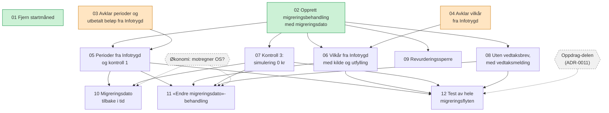

# Avhengigheter mellom ticketene

Ticketene ligger i [issues/](issues/), og spec-en i [spec.md](spec.md).

- Grønne tickets kan startes nå.
- Oransje tickets er `ready-for-human`.
- Grå sekskanter er blokkeringer utenfor repoet, tegnet med stiplede piler.

01 har ingen piler fordi ingen andre tickets avhenger av den.

