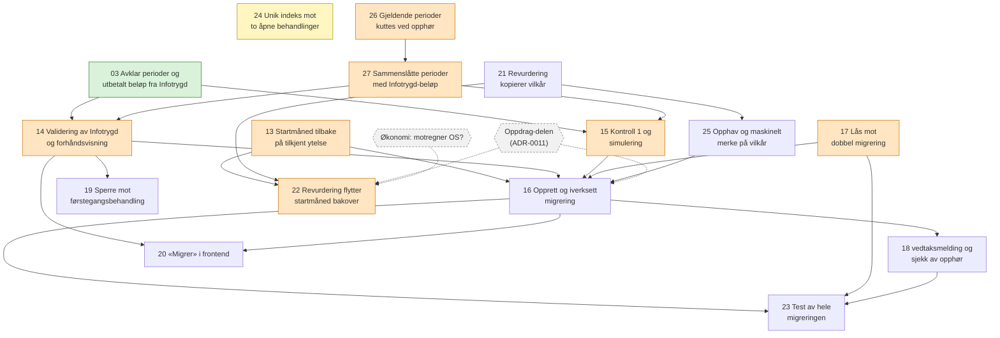

# Avhengigheter mellom ticketene

Ticketene ligger i [issues/](issues/), og spec-en i [spec.md](spec.md). Ticket 01,
02 og 04–12 er slettet (ADR-0013). Ticket 13 reverserer commit `1a4d1b3` fra
ticket 01.

- Hvite tickets er `ready-for-agent`.
- Oransje tickets er `ready-for-human`. De er rød sone eller krever kunnskap om
  Infotrygd.
- Gule tickets er `needs-triage`.
- Grønne tickets er løst.
- Grå sekskanter er blokkeringer utenfor repoet, tegnet med stiplede piler.

24 har ingen piler fordi ingen andre tickets avhenger av den.

03 er løst. 21 kan startes med en gang av en agent. 13, 17 og 26 kan også
startes, men er rød sone og skrives av en utvikler.
