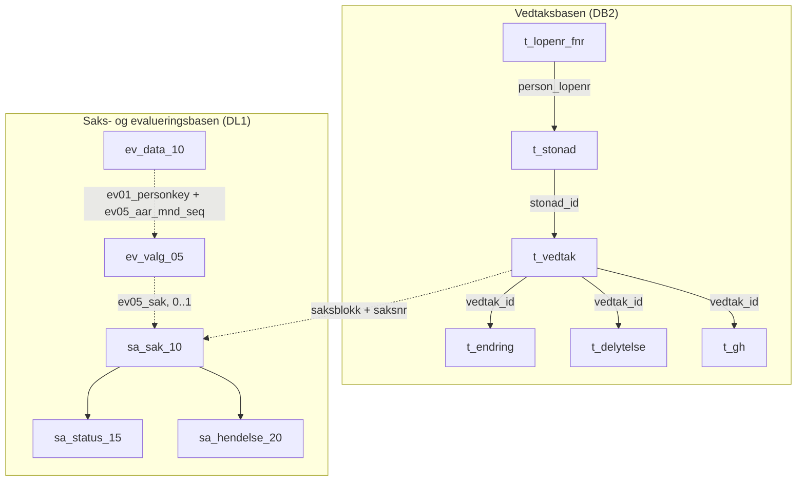

# Grunn- og hjelpestønad i Infotrygd

Bildene under er hentet fra Confluence-siden
[IT34_GH - Databasetabeller](https://confluence.adeo.no/spaces/INFOTRYGD/pages/126681693/IT34_GH+-+Databasetabeller).
Se [README](../README.md) for hvordan appen leser tabellene.

## Historikk

I 2009 konverterte Nav grunn- og hjelpestønad ut av pensjonsrutinen i
Infotrygd, og GH ble en egen rutine. Vedtak fra før 2009 ble fattet i
pensjonsrutinen.

## Tabellene vi replikerer

Diagrammet viser tabellene appen leser, og hvordan de henger sammen. Det bygger
på en tavleskisse av GH i Infotrygd, rettet etter det vi har målt i dev.
Tabellene ligger i to kilder i Infotrygd: vedtaksbasen (DB2) og saks- og
evalueringsbasen (DL1). Appen leser ikke kildene direkte, men en Postgres-replika
fra Exodus, med prefikset `t_` på tabellene fra vedtaksbasen.

Heltrukne piler følger nøklene i vedtaksbasen. Stiplede piler er koblinger på
tvers av kildene, og ingen av dem er fremmednøkler:

- **Vedtak og sak:** Et vedtak hører til saken med samme saksblokk og
  saksnummer. Én stønad kan gå over flere saker.
- **Evaluering og sak:** `ev05_sak` er saksblokk fulgt av saksnummer. En sak kan
  ha evalueringer for flere måneder, og appen bruker den siste. Maskinvedtak kan
  mangle evaluering. Evalueringen er derfor ikke 1:1 med vedtaket.
- **Evalueringsdata:** `ev_data_10` har ikke sak eller stønadstype. Radene hører
  til personen og måneden, ikke til én evaluering.

`t_vedtak.person_lopenr` kan avvike fra `t_stonad.person_lopenr`. Detaljene om
kolonner, formater og målinger står i README-en under
[Koblinger mellom tabellene](../README.md#koblinger-mellom-tabellene) og
[Evaluering](../README.md#evaluering).

## Systemskisse

## Datamodell for vedtak og stønad

Diagrammet har rundt 60 tabeller og dekker alle rutinene som bruker
vedtaksbasen, ikke bare GH. Vi replikerer `LOPENR_FNR`, `STONAD`, `VEDTAK`,
`GH`, `ENDRING` og `DELYTELSE`, med prefikset `t_` (se `ExodusTabell`).

### Tabeller vi ikke replikerer

Disse henger på `VEDTAK` og kan være aktuelle for GH:

| Tabell | Innhold |
|--------|---------|
| `BESLUT` | Saksbehandler, godkjenning og enhet for vedtaket |
| `ROLLE` | Personer med en rolle i vedtaket, med periode og trygdetid |
| `GRAD` | Grad per type og periode |

Ingen har bekreftet at `BESLUT`, `ROLLE` og `GRAD` er i bruk for GH.

`DIAGNOSE` er ikke i bruk for GH, ifølge en Infotrygd-ekspert. Den ble bare
brukt for tidsbegrenset uførestønad, som ikke finnes lenger. GH-diagnosene
ligger i evalueringen (`ev_data_10`, posisjon `055` og `100`).

Kodetabellene gir tekst til kodene: `ENDRINGSAARSAK` for `ENDRING.kode`,
`DELYTELSESTYPE`, `SATSTYPE` og `UTBETALINGSTYPE` for `DELYTELSE`,
`OPPHORSGRUNN` for `STONAD.kode_opphor`, `RUTINE` for `kode_rutine`,
`VEDTAKSNIVAA` og `BEREGNINGSTYPE` for `VEDTAK`.
