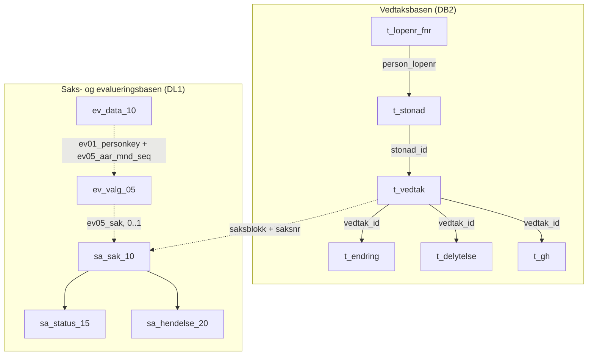

# Grunn- og hjelpestønad i Infotrygd

Bildene under er hentet fra Confluence-siden
[IT34_GH - Databasetabeller](https://confluence.adeo.no/spaces/INFOTRYGD/pages/126681693/IT34_GH+-+Databasetabeller).
Se [README](../README.md) for hvordan appen leser tabellene.

## Historikk

I 2009 konverterte Nav grunn- og hjelpestønad ut av pensjonsrutinen i
Infotrygd, og GH ble en egen rutine. Vedtak fra før 2009 ble fattet i
pensjonsrutinen.

## Tabellene vi replikerer

Diagrammet viser tabellene appen leser, og hvordan de henger sammen. Det bygger
på en tavleskisse av GH i Infotrygd, rettet etter det vi har målt i dev.
Tabellene ligger i to kilder i Infotrygd: vedtaksbasen (DB2) og saks- og
evalueringsbasen (DL1). Appen leser ikke kildene direkte, men en Postgres-replika
fra Exodus, med prefikset `t_` på tabellene fra vedtaksbasen.

Heltrukne piler følger nøklene i vedtaksbasen. Stiplede piler er koblinger på
tvers av kildene, og ingen av dem er fremmednøkler:

- **Vedtak og sak:** Et vedtak hører til saken med samme saksblokk og
  saksnummer. Én stønad kan gå over flere saker.
- **Evaluering og sak:** `ev05_sak` er saksblokk fulgt av saksnummer. En sak kan
  ha evalueringer for flere måneder, og appen bruker den siste. Maskinvedtak kan
  mangle evaluering. Evalueringen er derfor ikke 1:1 med vedtaket.
- **Evalueringsdata:** `ev_data_10` har ikke sak eller stønadstype. Radene hører
  til personen og måneden, ikke til én evaluering.

`t_vedtak.person_lopenr` kan avvike fra `t_stonad.person_lopenr`. Detaljene om
kolonner, formater og målinger står i README-en under
[Koblinger mellom tabellene](../README.md#koblinger-mellom-tabellene) og
[Evaluering](../README.md#evaluering).

## Systemskisse

## Datamodell for vedtak og stønad

Diagrammet har rundt 60 tabeller og dekker alle rutinene som bruker
vedtaksbasen, ikke bare GH. Vi replikerer `LOPENR_FNR`, `STONAD`, `VEDTAK`,
`GH`, `ENDRING` og `DELYTELSE`, med prefikset `t_` (se `ExodusTabell`).

### Tabeller vi ikke replikerer

Disse henger på `VEDTAK` og kan være aktuelle for GH:

| Tabell | Innhold |
|--------|---------|
| `BESLUT` | Saksbehandler, godkjenning og enhet for vedtaket |
| `ROLLE` | Personer med en rolle i vedtaket, med periode og trygdetid |
| `GRAD` | Grad per type og periode |

Ingen har bekreftet at `BESLUT`, `ROLLE` og `GRAD` er i bruk for GH.

`DIAGNOSE` er ikke i bruk for GH, ifølge en Infotrygd-ekspert. Den ble bare
brukt for tidsbegrenset uførestønad, som ikke finnes lenger. GH-diagnosene
ligger i evalueringen (`ev_data_10`, posisjon `055` og `100`).

Kodetabellene gir tekst til kodene: `ENDRINGSAARSAK` for `ENDRING.kode`,
`DELYTELSESTYPE`, `SATSTYPE` og `UTBETALINGSTYPE` for `DELYTELSE`,
`OPPHORSGRUNN` for `STONAD.kode_opphor`, `RUTINE` for `kode_rutine`,
`VEDTAKSNIVAA` og `BEREGNINGSTYPE` for `VEDTAK`.

### Endringskoder

Kodene i `t_endring.kode`, med teksten fra `ENDRINGSAARSAK`. Tekstene står slik de er i Infotrygd. Frontend viser
teksten fra
[`endringskoder.ts`](../../frontend/app/komponenter/infotrygd/endringskoder.ts),
så oppdater begge stedene.

| Kode | Tekst |
|------|-------|
| `AN` | Annullert |
| `AS` | Avgang småbarnstillegg |
| `B` | Barnetillegg |
| `BB` | Barn 18 år |
| `E` | Endring i beregningsgrunnlag |
| `F` | Førstegangsvedtak |
| `G` | G-regulering |
| `H` | Barn etterlatte.3 måneder |
| `I` | Institusjonsopphold |
| `IN` | Ny inntektsgr. |
| `KB` | Barn 3 år |
| `NB` | Nytt barn |
| `NY` | Ny |
| `O` | Opphørt |
| `S` | Satsendring |
| `TS` | Tilgang småbarnstillegg |
| `U` | Uføregrad |
| `UA` | Uaktuell |
| `P` | Passivt |
| `AV` | Avslag |
| `OO` | Overf ny løsning |

### Sakstyper og resultatkoder

Kodene i `t_vedtak.type_sak` og `t_vedtak.kode_resultat`. Tekstene kommer fra
en Infotrygd-ekspert og står i kodetabellen med `KT1_TEKSTTYPE` lik `T` for
sakstype og `R` for resultat. Kodetabellen dekker alle rutinene, så bare kodene
som finnes på GH-vedtak, er med her. Tekstene står slik de er i Infotrygd.
Frontend viser teksten fra
[`vedtakskoder.ts`](../../frontend/app/komponenter/infotrygd/vedtakskoder.ts),
så oppdater begge stedene.

Kolonnene GS og HS er antall vedtak per kode, oppgitt av teamet 2026-10-27.
Summen er lik for de to tabellene: 1 894 592 vedtak for GS og 1 310 420 for HS.

#### Sakstype (`type_sak`)

| Kode | Tekst | GS | HS |
|------|-------|---:|---:|
| `A` | Anke | 1 | 6 |
| `FU` | Flytting til utlandet | 0 | 2 |
| `K` | Klage | 3 286 | 4 042 |
| `KO` | Konverteringssak | 129 969 | 84 811 |
| `MO` | Manuell satsomregning | 3 889 | 3 683 |
| `MS` | Maskinell satsomregning | 1 507 834 | 892 434 |
| `R` | Revurdering | 139 831 | 185 209 |
| `S` | Søknad | 103 692 | 123 139 |
| `SØ` | Søknad om økning/endring | 6 090 | 17 094 |

#### Resultat (`kode_resultat`)

| Kode | Tekst | GS | HS |
|------|-------|---:|---:|
| `A` | Avslag | 1 | 0 |
| `AN` | Annulert | 864 | 790 |
| `DI` | Delvis innvilget | 2 189 | 504 |
| `FI` | Fortsatt innvilget | 1 637 434 | 1 062 434 |
| `HB` | Henlagt / bortfalt | 0 | 1 |
| `I` | Innvilget | 110 728 | 143 547 |
| `IN` | Innvilget ny situasjon | 101 | 108 |
| `K` | Konvertert | 129 969 | 84 811 |
| `MO` | Midlertidig opphørt | 189 | 137 |
| `MR` | Ukjent, se under | 12 | 0 |
| `R` | Redusert | 9 452 | 11 361 |
| `Ø` | Økning | 3 653 | 6 727 |

- `MR` finnes ikke som resultat i kodetabellen. Som sakstype betyr `MR`
  «Maskinell revurdering», men det er ikke bekreftet at resultatet betyr det
  samme. Frontend viser bare koden.
- Resultat `K` og sakstype `KO` har like mange vedtak. Trolig er dette vedtakene
  fra konverteringen ut av pensjonsrutinen i 2009 (se [Historikk](#historikk)),
  men det er ikke sjekket at det er de samme vedtakene.
- `MS` med `FI` er den vanligste kombinasjonen: vedtak Infotrygd lager selv når
  satsene endres. Slike vedtak kan mangle evaluering, se README-en under
  [Kjente tilfeller uten evaluering](../README.md#kjente-tilfeller-uten-evaluering).

### Delytelser

Kodene i `t_delytelse`, oppgitt av teamet 2026-10-27. For GH har hver kolonne
bare én verdi per stønadstype, så frontend viser ingen av dem. API-et returnerer
dem fortsatt.

| Kolonne | Kode | Tekst |
|---------|------|-------|
| `type_delytelse` | `MG` | Grunnstønad månedsats. Alltid `MG` for GS. |
| `type_delytelse` | `MH` | Hjelpestønad månedsats. Alltid `MH` for HS. |
| `type_sats` | `M` | Alltid `M`. Teksten er ikke kjent. |
| `type_utbetaling` | `L` | Alltid `L`. Teksten er ikke kjent. |
